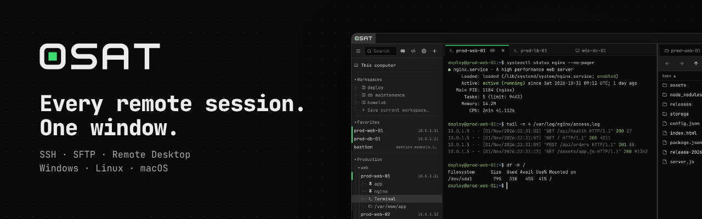
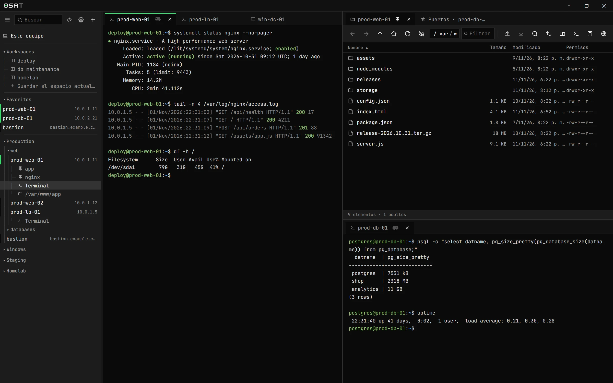
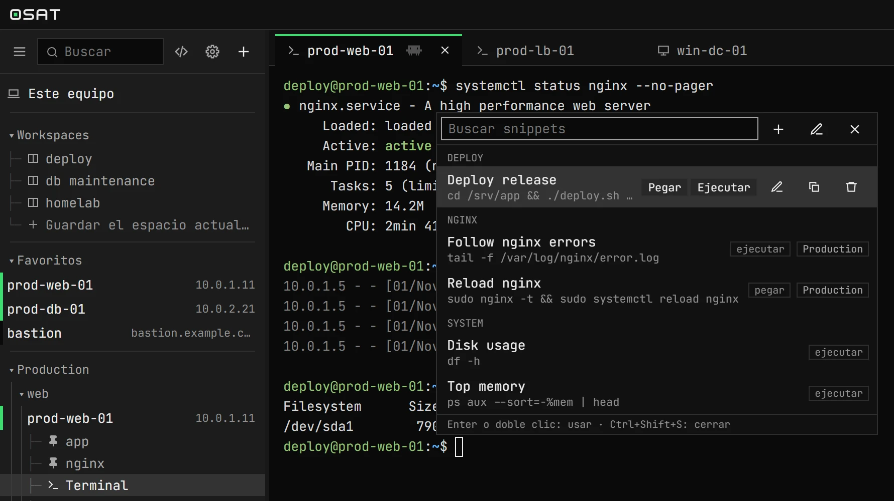
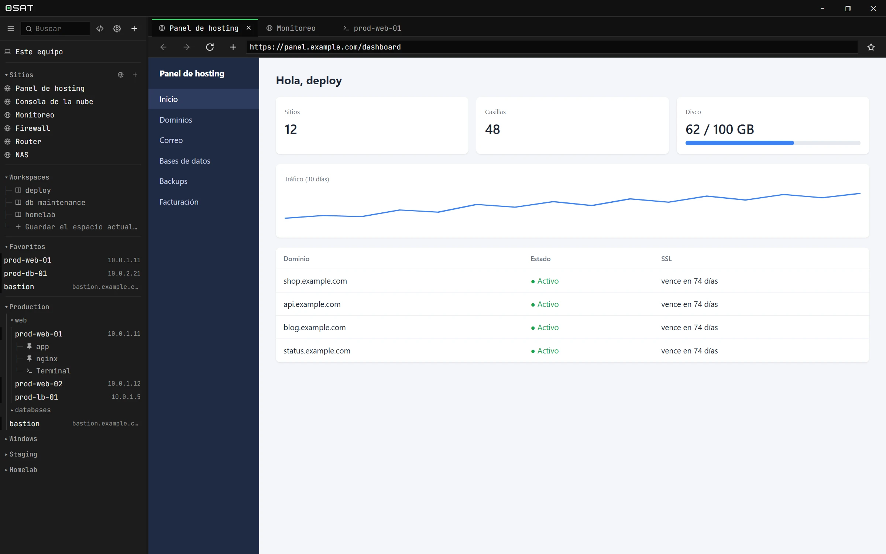

<p align="center">
  
</p>

<p align="center">
  <a href="https://github.com/brunomick/osat/releases/latest"></a>
  <a href="LICENSE"></a>
  
</p>

<p align="center">
  <a href="README.md">English</a> · <b>Español</b> · <a href="https://brunomick.github.io/osat/?lang=es">Sitio web</a>
</p>

**osat** es un cliente SSH, SFTP y de escritorio remoto (RDP y VNC) libre y gratuito para Windows, Linux y macOS, con una beta para Android. Terminales, archivos, escritorios remotos y consolas web quedan uno al lado del otro en pestañas en mosaico, y las contraseñas se guardan en el llavero del sistema.



## Funcionalidades

- **Terminal SSH** con claves, doble factor, agentes y saltos por bastión. Se reconecta sola y guarda la sesión como texto.
- **SFTP** con arrastrar y soltar, búsqueda, sincronización de carpetas, transferencias que se retoman y edición como root.
- **Escritorio remoto**: RDP (también a través de un RD Gateway) y VNC, dentro de una pestaña y sin instalar nada más.
- **Reenvío de puertos**: local, remoto, SOCKS y Kubernetes, con atajos para las bases de datos de siempre.
- **Mosaico y espacios de trabajo**: dividí la ventana como quieras y seguí donde lo dejaste.
- **Snippets y broadcast**: comandos guardados con variables, en una terminal o en varias a la vez.
- **Importa** de PuTTY, WinSCP, mRemoteNG y OpenSSH, y exporta todo a un archivo `.osat` cifrado para llevarlo a otra PC.
- **Sitios web y navegador integrado** para tus consolas web y para ver los puertos de un servidor.
- **Claude MCP**: dejá que [Claude Code](https://claude.com/claude-code) trabaje en las terminales que elijas compartir.
- **Seguro por defecto**: huellas de host verificadas, contraseñas en el llavero y bloqueo opcional (o Windows Hello).
- **Se actualiza sola**: cuando sale una versión nueva, osat te muestra qué trae y la instala con un clic.
- **18 temas**, oscuros y claros, en español o inglés.

<table>
  <tr>
    <td></td>
    <td></td>
  </tr>
  <tr>
    <td align="center"><sub>Snippets, a un atajo de distancia</sub></td>
    <td align="center"><sub>Tus paneles de administración, al lado de tus servidores</sub></td>
  </tr>
</table>

## Descarga

Bajá el archivo de tu sistema de la **[última versión](https://github.com/brunomick/osat/releases/latest)**:

| Sistema | Archivo | Cómo instalarlo |
|---|---|---|
| **Windows** 10 y 11 | `…-windows-x64-setup.exe` | Ejecutá el instalador. Si Windows dice que la app no es conocida: *Más información → Ejecutar de todas formas*. También hay un `…-portable.zip` que anda sin instalar. |
| **Linux** (Ubuntu 22.04+, Debian 12+) | `…-linux-x64.tar.gz` | `sudo apt install libwebkit2gtk-4.1-0` y después `tar xzf osat-*.tar.gz && sh osat-linux/instalar.sh`. osat no necesita `sudo` y aparece en el menú de aplicaciones. |
| **macOS** (Apple silicon e Intel) | `…-macos-universal.zip` | Descomprimilo y mové osat a *Aplicaciones*. La app no está firmada: la primera vez, clic derecho → *Abrir*. |

- **Android (beta)**: terminal SSH y SFTP. Por ahora se compila desde el código: ver [android/README.md](android/README.md).

## Compilar

Hace falta Go 1.25+, Node.js 18+ y la CLI de Wails:

```bash
go install github.com/wailsapp/wails/v2/cmd/wails@v2.16.0
wails dev     # la app con recarga en caliente (en Linux, agregá -tags webkit2_41)
wails build   # → build/bin/osat(.exe)
```

Tests: `go test ./internal/...` y `cd frontend && npm test`. Los requisitos de cada sistema, el paquete para Linux, los atajos, el puente con Claude Code, la estructura del proyecto y las notas de diseño están en [docs/desarrollo.md](docs/desarrollo.md).

## Tus datos

Las conexiones, los ajustes y los logs se guardan en `%APPDATA%\osat\` (Windows), `~/Library/Application Support/osat/` (macOS) o `~/.config/osat/` (Linux). Las contraseñas nunca se escriben ahí, y el log nunca registra contraseñas, claves ni lo que escribís.

## Contribuir

Los reportes de errores, las ideas y los pull requests son bienvenidos: ver [CONTRIBUTING.md](CONTRIBUTING.md). Las vulnerabilidades se reportan en privado, como dice [SECURITY.md](SECURITY.md).

## Licencia

[GPL-3.0 o posterior](LICENSE). Copyright (C) 2026 Bruno Mick. Las licencias de terceros están en [THIRD_PARTY_NOTICES.md](THIRD_PARTY_NOTICES.md).
