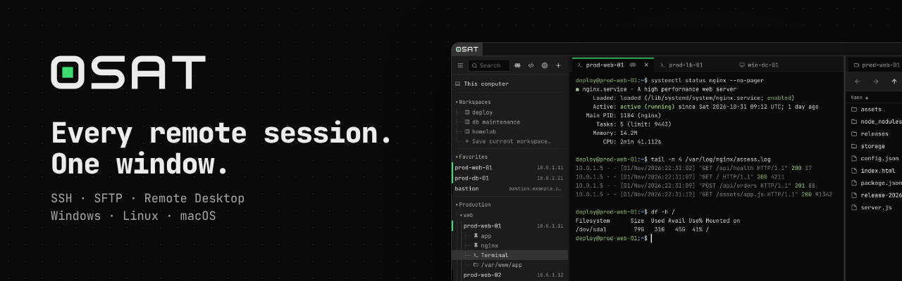
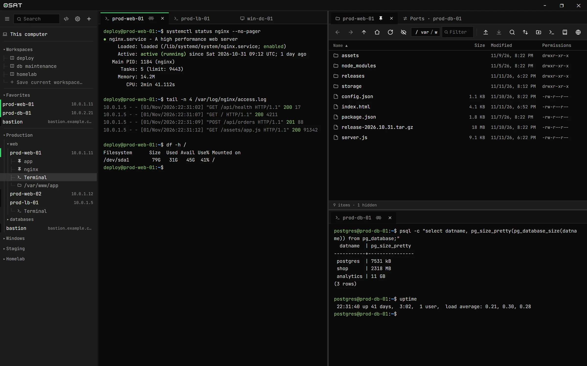
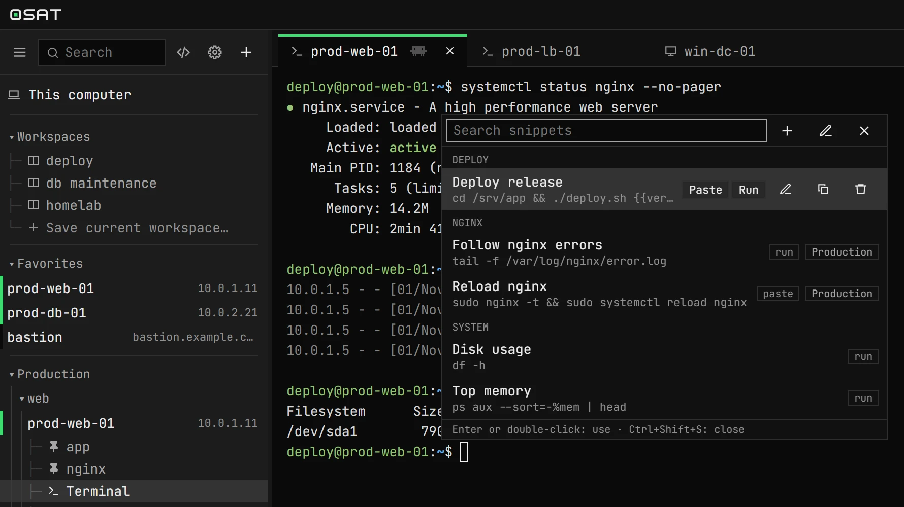
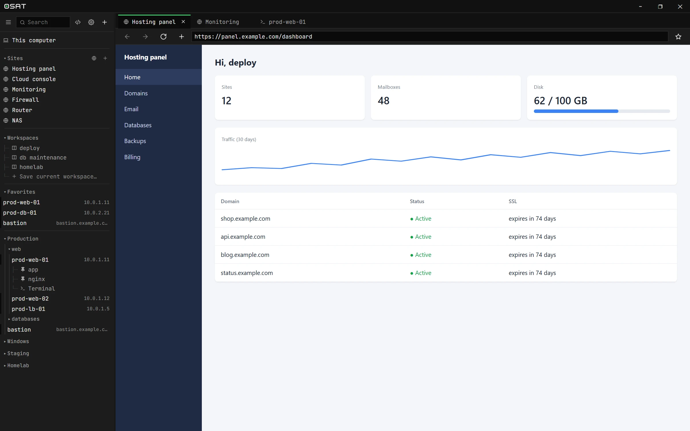

<p align="center">
  
</p>

<p align="center">
  <a href="https://github.com/brunomick/osat/releases/latest"></a>
  <a href="LICENSE"></a>
  
</p>

<p align="center">
  <b>English</b> · <a href="README.es.md">Español</a> · <a href="https://brunomick.github.io/osat/">Website</a>
</p>

**osat** is a free, open-source SSH, SFTP and remote desktop (RDP and VNC) client for Windows, Linux and macOS, with an Android beta. Terminals, files, remote desktops and web consoles live side by side in tiled tabs, and your passwords stay in the operating system's keyring.



## Features

- **SSH terminal** with keys, 2FA, agents and jump hosts. Reconnects on its own and saves the session as text.
- **SFTP** with drag and drop, search, folder sync, resumable transfers and editing as root.
- **Remote desktop**: RDP (also through an RD Gateway) and VNC, inside a tab, with nothing else to install.
- **Port forwarding**: local, remote, SOCKS and Kubernetes, with presets for the usual databases.
- **Tiles and workspaces**: split the window any way you like and pick up where you left off.
- **Snippets and broadcast**: saved commands with variables, typed into one terminal or several at once.
- **Imports** from PuTTY, WinSCP, mRemoteNG and OpenSSH, and an encrypted `.osat` file to move everything to another PC.
- **Websites and a built-in browser** for your web consoles and for previewing a server's ports.
- **Claude MCP**: let [Claude Code](https://claude.com/claude-code) work in the terminals you choose to share.
- **Secure by default**: verified host keys, passwords in the keyring and an optional lock screen (or Windows Hello).
- **Updates itself**: when a new version is out, osat shows what's in it and installs it with one click.
- **18 themes**, dark and light, in English or Spanish.

<table>
  <tr>
    <td></td>
    <td></td>
  </tr>
  <tr>
    <td align="center"><sub>Snippets, one keystroke away</sub></td>
    <td align="center"><sub>Your admin panels, next to your servers</sub></td>
  </tr>
</table>

## Download

Download the file for your system from the **[latest release](https://github.com/brunomick/osat/releases/latest)**:

| System | File | How to install |
|---|---|---|
| **Windows** 10 and 11 | `…-windows-x64-setup.exe` | Run the installer. If Windows says the app is unrecognized: *More info → Run anyway*. There's also a `…-portable.zip` that runs without installing. |
| **Linux** (Ubuntu 22.04+, Debian 12+) | `…-linux-x64.tar.gz` | `sudo apt install libwebkit2gtk-4.1-0`, then `tar xzf osat-*.tar.gz && sh osat-linux/instalar.sh`. No `sudo` needed for osat itself; it shows up in your applications menu. |
| **macOS** (Apple silicon and Intel) | `…-macos-universal.zip` | Unzip and move osat to *Applications*. The app isn't signed: the first time, right-click it → *Open*. |

- **Android (beta)**: SSH terminal and SFTP. For now you build it from source: see [android/README.md](android/README.md).

## Build from source

You need Go 1.25+, Node.js 18+ and the Wails CLI:

```bash
go install github.com/wailsapp/wails/v2/cmd/wails@v2.16.0
wails dev     # run with hot reload (on Linux add -tags webkit2_41)
wails build   # → build/bin/osat(.exe)
```

Tests: `go test ./internal/...` and `cd frontend && npm test`. System requirements per platform, packaging, the project layout and design notes are in [docs/desarrollo.md](docs/desarrollo.md) (Spanish).

## Your data

Connections, settings and logs live in `%APPDATA%\osat\` (Windows), `~/Library/Application Support/osat/` (macOS) or `~/.config/osat/` (Linux). Passwords are never written there, and the log never records passwords, keys or what you type.

## Contributing

Bug reports, ideas and pull requests are welcome: see [CONTRIBUTING.md](CONTRIBUTING.md). Report security issues privately as described in [SECURITY.md](SECURITY.md).

## License

[GPL-3.0-or-later](LICENSE). Copyright (C) 2026 Bruno Mick. Third-party licenses are listed in [THIRD_PARTY_NOTICES.md](THIRD_PARTY_NOTICES.md).
